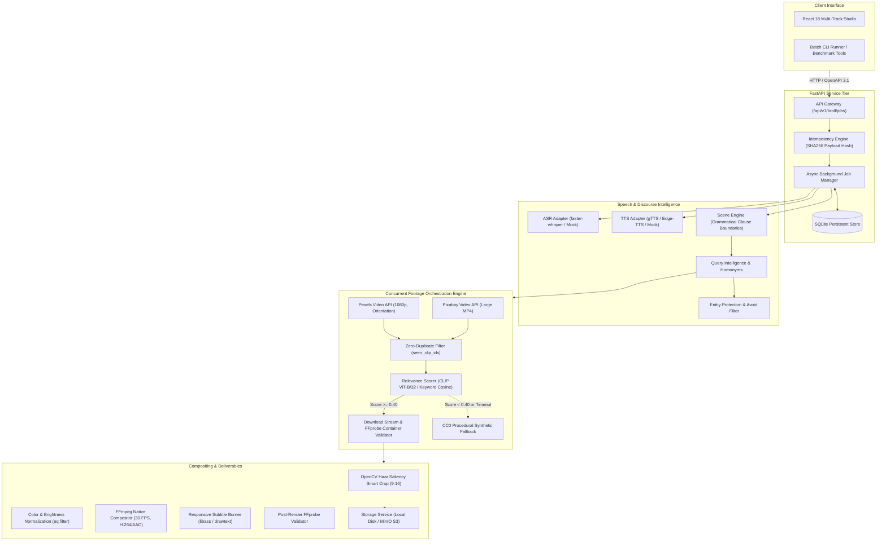
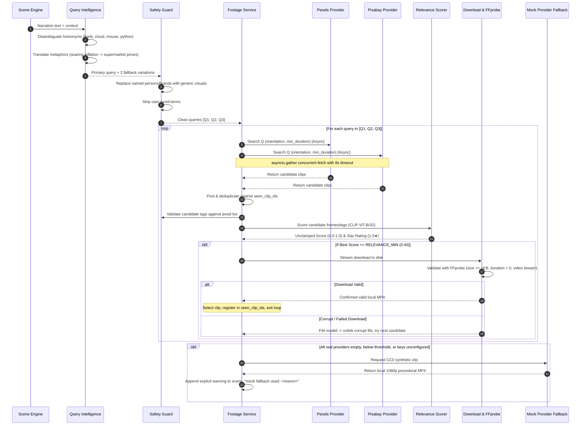

# ARCHITECTURE.md – FrameFlow AI Technical Architecture

This document provides a comprehensive technical breakdown of the FrameFlow AI pipeline, detailing the concurrent footage acquisition engine, meaning-based discourse segmentation, relevance scoring mechanisms, and FFmpeg video compositing.

---

## 1. High-Level System Architecture

---

## 2. Footage Pipeline & Fallback Chain

The footage orchestration engine enforces strict commercial compliance, concurrency, query variations, and download integrity:

---

## 3. Homonym Disambiguation Architecture

FrameFlow AI resolves double-meaning words based on contextual tokens in the narration phrase:

| Homonym | Tech Context Keywords | Tech Visual Output | Nature/Literal Context | Nature Visual Output |
| :--- | :--- | :--- | :--- | :--- |
| **`bank`** | money, finance, deposit, loan, account, cash, savings | `financial corporate banking` | river, stream, shore, water, flowers, grass | `river bank nature` |
| **`cloud`** | data, server, computing, storage, network, AWS, software | `server room technology` | sky, cumulus, weather, blue, time-lapse | `clouds sky time-lapse` |
| **`mouse`** | computer, click, screen, laptop, cursor, desk | `computer mouse desk` | rodent, wild, field, outdoor, grass | `field mouse nature` |
| **`python`** | code, programming, developer, software, script, algorithm | `software developer coding` | snake, rainforest, branch, reptile, wildlife | `python snake wildlife` |
| **`value`** | sales, revenue, growth, stock, market, finance, investor | `stock market chart growth` | partnership, handshake, agreement, trust | `business partnership handshake` |

---

## 4. Entity Safety & Real Person Guard

To maintain strict commercial clearance and brand safety:
1. **Real Public Figures:** Automatically replaced with generic professional stand-ins.
   - *Input:* `"Elon Musk announces new technology initiative."`
   - *Transformed Intent:* `"technology entrepreneur and tech executive stage presentation announces new technology initiative."`
   - *Timeline Record:* Safety warning logged: `"Safety Guard: Detected real person / brand entity 'elon musk'. Substituted with generic commercial stand-in footage; realistic likeness suppressed."`
2. **Commercial Brands:** Replaced with generic product visuals (`"Apple iPhone"` $\to$ `"modern smartphone with glass display"`).
3. **Sensitive Tragedies / Disasters:** Enforces solemn, respectful landscape reflection and suppresses celebratory or graphic terms.
4. **User `avoid` Directives:** Stripped from query generation and enforced as strict blocklist on candidate clip tags.

---

## 5. Honest Relevance Scoring Specification

1. **Primary Model:** CLIP (`open_clip` ViT-B/32) measuring cosine similarity between keyframe and narration text:
   $$\text{Similarity} = \frac{\mathbf{v}_{\text{image}} \cdot \mathbf{v}_{\text{text}}}{\|\mathbf{v}_{\text{image}}\| \|\mathbf{v}_{\text{text}}\|}$$
2. **Fallback Model:** Calibrated Jaccard token overlap between query synset and candidate clip tags.
3. **Unclamped Scaling:**
   - 0.80 - 1.00 $\to$ 5 Stars (Excellent semantic and visual alignment)
   - 0.65 - 0.79 $\to$ 4 Stars (Strong match)
   - 0.50 - 0.64 $\to$ 3 Stars (Acceptable contextual match)
   - 0.35 - 0.49 $\to$ 2 Stars (Marginal alignment)
   - $< 0.35$ $\to$ 1 Star (Weak match / rejected if candidate pool allows)
4. **Transparency Contract:** The exact method is honestly declared in `timeline.json`, `manifest.json`, and the UI (`"CLIP ViT-B/32"` or `"Keyword overlap similarity heuristic"`). Heuristic overlap is never falsely labeled as "VLM".

---

## 6. Deliverable Specifications

Every job produces 6 deliverables verified by FFprobe:
1. `video_16_9.mp4`: 1920x1080 Landscape, 30 FPS, H.264 / AAC 192kbps.
2. `video_9_16.mp4`: 1080x1920 Portrait, Smart Saliency Crop, 30 FPS.
3. `video_1_1.mp4`: 1080x1080 Square, 30 FPS.
4. `captions.srt`: SubRip subtitle file with millisecond timestamp synchronization.
5. `timeline.json`: Complete per-scene metadata, provider provenance, commercial licence, and relevance scores.
6. `manifest.json`: Cryptographic seed, model inventory, stage timings, estimated compute cost, and licensing audit.
