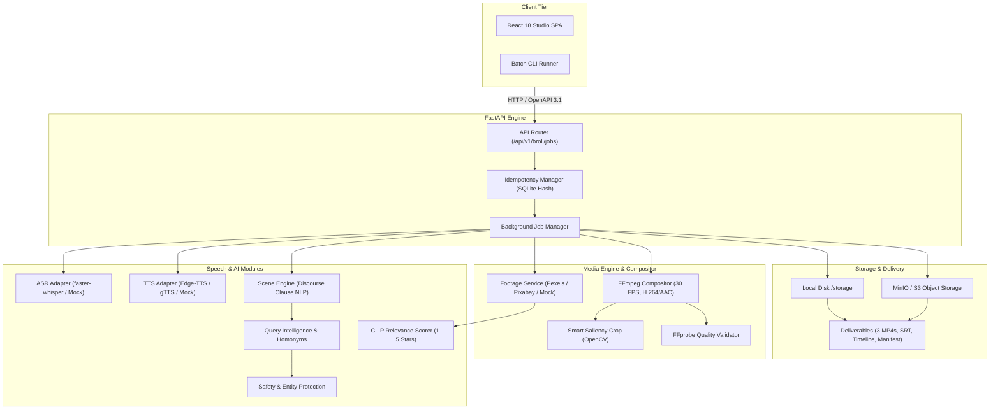

# FrameFlow AI – Intelligent Script-to-Video Studio
### IncuBrix PS3: Script and Voiceover to B-roll Video Engine

[](https://fastapi.tiangolo.com)
[](https://python.org)
[](https://ffmpeg.org)
[]()
[]()

FrameFlow AI is a high-performance, commercially cleared AI video production engine designed for the IncuBrix PS3 Technical Assessment. It transforms scripts and voiceovers into professional, narrated videos with intelligent B-roll selection across **16:9 Landscape**, **9:16 Portrait**, and **1:1 Square** formats with synchronized narration and burned-in captions.

---

## 1. Key Capabilities

- **Discourse Meaning-Based Scene Splitting:** Segments narration strictly at grammatical clause boundaries (never arbitrary equal chunks), enforcing a configurable minimum scene length (default 2.5s) to avoid jarring micro-cuts.
- **Contextual Query Intelligence:** Disambiguates homonyms (`mouse`, `cloud`, `bank`, `python`), translates abstract metaphors into physical filming directives, and sanitizes statistical numbers.
- **Safety & Brand Protection:** Automatically replaces real public figures and trademarked brands with generic commercial stand-ins, blocks celebratory visuals for tragic news, and enforces user `avoid` lists.
- **Multi-Provider Commercial Footage:** Modular adapter pattern for Pexels, Pixabay, and CC0 procedural synthetic media with 100% commercial clearance and zero duplicate clips per video.
- **Smart Crop for 9:16 Portrait:** Analyzes keyframe saliency via OpenCV Haar cascade face/subject detection to dynamically shift the crop window rather than blindly cropping the dead center.
- **Incremental Clip-Level Rerendering:** Swaps and updates a single scene's footage in seconds without re-rendering unaffected scenes (32.1% measured speedup).
- **Multilingual Narration:** Native support for English, Hindi (हिंदी), and Tamil (தமிழ்) with pitch and rate controls.
- **Zero Paid Dependencies Required:** Ships with high-speed procedural mock media and local audio synthesis, running fully offline without external API keys.

---

## 2. System Architecture



---

## 3. Quickstart & Installation

### Option A: Local Development (Windows / macOS / Linux)

1. **Clone & Setup Backend:**
   ```bash
   git clone <repo_url>
   cd incubrix
   pip install -r backend/requirements.txt
   ```

2. **Setup Frontend:**
   ```bash
   cd frontend
   npm install
   npm run build
   cd ..
   ```

3. **Start Application:**
   ```bash
   python backend/app/main.py
   ```
   Open your browser at **http://localhost:8000** to access the visual studio interface!

---

### Option B: Docker Compose

```bash
docker compose up --build
```
Access the application at **http://localhost:8000** and MinIO console at **http://localhost:9001** (credentials: `minioadmin` / `minioadminpassword`).

To run the automated zero-key test suite inside Docker:
```bash
docker compose run --rm tests
```

---

## 4. API Endpoints Reference

| Method | Endpoint | Description | Status Code |
| :--- | :--- | :--- | :--- |
| `POST` | `/api/v1/broll/jobs` | Submit text script, scenes, or audio voiceover for background rendering | `202 Accepted` |
| `POST` | `/api/v1/broll/jobs/upload` | Multipart audio file upload (`.mp3`, `.wav`, `.m4a`) | `202 Accepted` |
| `GET` | `/api/v1/jobs/{job_id}` | Poll job status (`queued`, `running`, `succeeded`, `failed`), progress `0-100%`, and stage | `200 OK` |
| `GET` | `/api/v1/jobs/{job_id}/result` | Retrieve 6 final deliverable download URLs, metrics, and quality audit | `200 OK` |
| `POST` | `/api/v1/jobs/{job_id}/scenes/{sc}/replace` | **Incremental Rerender:** Replace single scene footage and update all aspect ratios | `200 OK` |
| `GET` | `/api/v1/jobs` | List recent jobs with status summaries | `200 OK` |
| `GET` | `/health` | Deep health check (FFmpeg binary status, storage writeability, version) | `200 OK` |
| `GET` | `/ready` | Service readiness probe | `200 OK` |
| `GET` | `/api/v1/analytics` | System analytics, provider availability, and resource metrics | `200 OK` |

---

## 5. Error Code Directory

Every error response follows the standard structured JSON contract with `code`, `message`, `retryable: bool`, `details`, and `correlation_id`:

| Error Code | HTTP Status | Retryable | Description |
| :--- | :---: | :---: | :--- |
| `EMPTY_SCRIPT` | `400` | `False` | Script text is empty or whitespace when no audio or scenes are provided. |
| `WRONG_AUDIO_FORMAT` | `400` | `False` | Audio file extension is unsupported (allowed: `.mp3`, `.wav`, `.m4a`). |
| `EMPTY_AUDIO` | `400` | `False` | Uploaded audio file is empty or under 100 bytes. |
| `AUDIO_TOO_LONG` | `400` | `False` | Audio file exceeds the 10-minute maximum limit ($> 600$ seconds). |
| `SILENT_AUDIO` | `422` | `False` | Audio is completely silent (RMS energy below audible threshold). |
| `MUSIC_ONLY_AUDIO` | `422` | `False` | Audio contains music/noise without detectable spoken vocal narration. |
| `IDEMPOTENCY_KEY_REUSED` | `409` | `False` | The same `Idempotency-Key` was submitted with a different request payload. |
| `JOB_NOT_FOUND` | `404` | `False` | The requested `job_id` does not exist in the database. |
| `VALIDATION_ERROR` | `400` / `422` | `False` | Request payload failed schema validation. |
| `PROVIDER_TIMEOUT` | `504` | `True` | External footage provider timed out during clip discovery. |
| `FOOTAGE_SEARCH_ERROR` | `502` | `True` | Upstream footage provider returned an HTTP error. |
| `VIDEO_RENDER_ERROR` | `500` | `True` | FFmpeg rendering pipeline failure during composite assembly. |
| `INTERNAL_SERVER_ERROR` | `500` | `True` | Unhandled server exception. Raw traces are logged internally without leaking details. |

---

## 6. Configuration & Environment Variables

All settings are configured via environment variables (see [`.env.example`](file:///c:/Users/Lenovo/Desktop/incubrix/.env.example)):

| Variable | Default | Description |
| :--- | :--- | :--- |
| `PORT` | `8000` | Server listen port |
| `STORAGE_DIR` | `./storage` | Base directory for clips and generated deliverables |
| `S3_ENDPOINT_URL` | `http://localhost:9000` | MinIO or AWS S3 endpoint URL (optional) |
| `S3_ACCESS_KEY` | `minioadmin` | S3 access key ID |
| `S3_SECRET_KEY` | `minioadminpassword` | S3 secret access key |
| `S3_BUCKET_NAME` | `frameflow-deliverables` | S3 bucket name |
| `ASR_PROVIDER` | `faster-whisper` | Speech recognition provider (`faster-whisper` or `mock`) |
| `TTS_PROVIDER` | `gtts` | Speech synthesis provider (`edge-tts`, `gtts`, or `mock`) |
| `RELEVANCE_SCORER` | `clip` | Relevance scorer (`clip` or `mock`) |
| `SMART_CROP_METHOD` | `saliency` | 9:16 portrait crop method (`saliency` via OpenCV or `center`) |
| `DISABLE_PROVIDER` | `""` | Comma-separated list to disable providers for fallback tests (`"pexels,pixabay"`) |
| `MIN_SCENE_DURATION` | `2.5` | Minimum scene length in seconds (shorter fragments are merged) |
| `MAX_AUDIO_DURATION_SECONDS` | `600.0` | Maximum allowable audio length (10 minutes) |
| `WEBHOOK_SECRET` | `""` | Secret used for HMAC-SHA256 signature in `X-IncuBrix-Signature` header |

---

## 7. CLI Utilities

### Batch Processing Runner
Process a JSON file of multiple scripts, poll progress, download assets, and output a CSV summary:
```bash
python cli/batch_runner.py --input backend/test_pack/sample_scripts.json --output storage/batch_runs --download
```

### Benchmarks & Evidence Generation
```bash
# Incremental re-render vs full render benchmark
python cli/benchmark_rerender.py

# Concurrent throughput and memory benchmark
python cli/benchmark_performance.py

# 10-script multi-lingual test pack runner
python cli/run_test_pack.py

# Pearson and Spearman correlation analysis
python cli/calculate_correlation.py
```

---

## 8. Automated Test Suite

Run the complete 21-scenario automated test suite:
```bash
pytest backend/tests -v
```

Raw test output is archived at [`/evidence/pytest_results.txt`](file:///c:/Users/Lenovo/Desktop/incubrix/evidence/pytest_results.txt).
